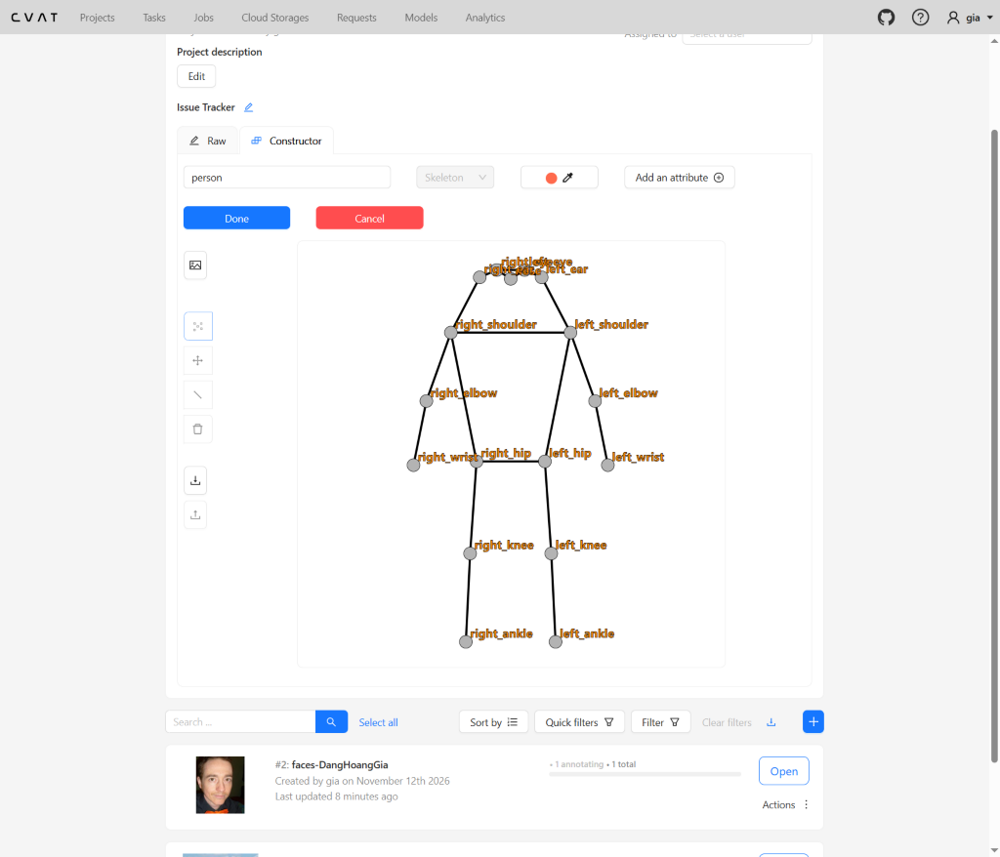
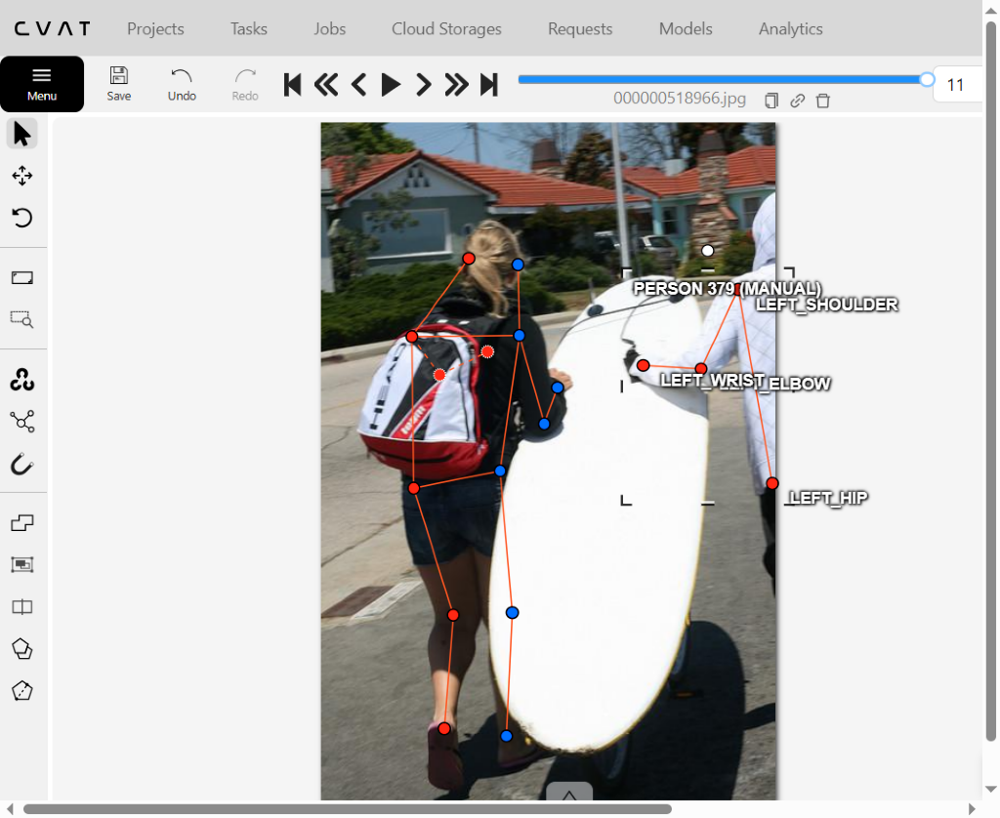
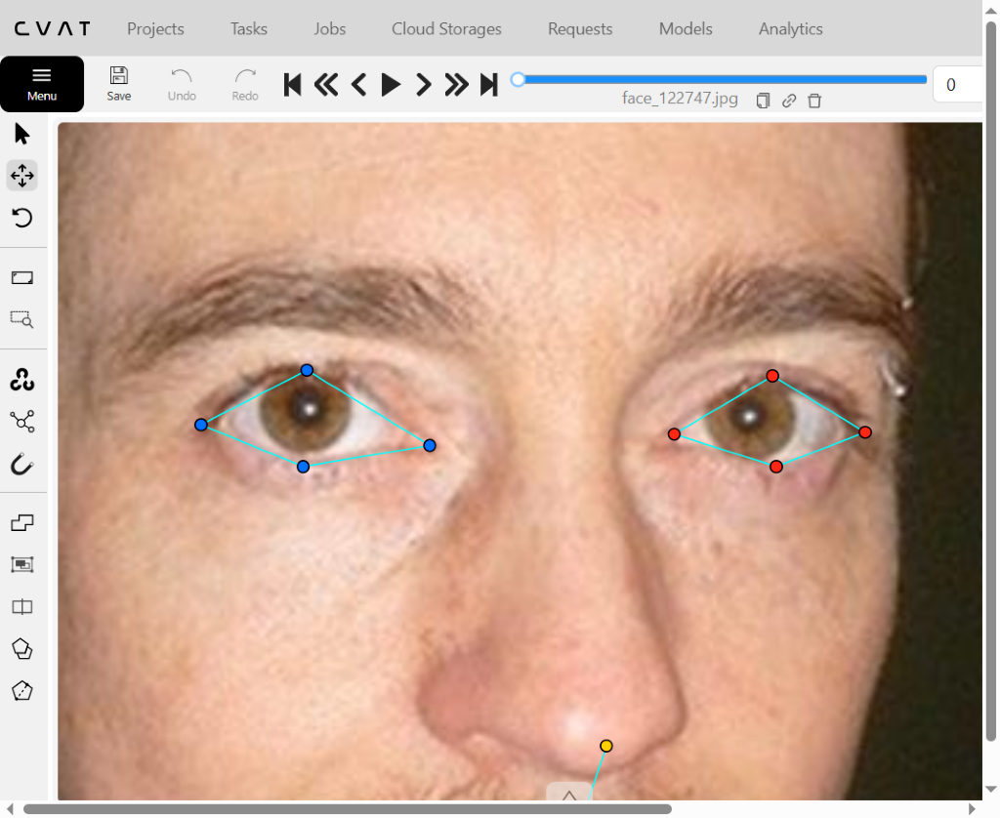
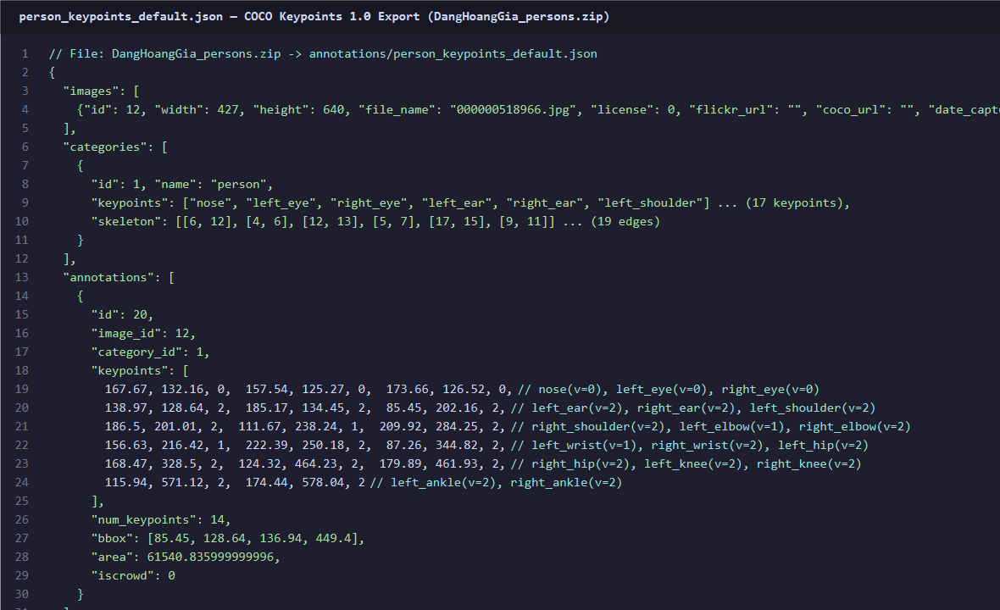

# Báo cáo cá nhân — DangHoangGia-2A202603065

Đổi tên file theo quy tắc `MSSV_HoTen.md`. Ví dụ: `20241234_NguyenVanAn.md`.

Dữ liệu: 12 ảnh người COCO val2017 / train2017 (Lin et al., 2014) và 8 ảnh chân dung cắt từ COCO (CC BY / CC BY-SA), chỉ dùng trong lớp.

## 0. Thông tin học viên

- Họ tên: Đặng Hoàng Gia
- MSSV: 2A202603065
- Email: danggia2412@gmail.com
- Link repository: https://github.com/dieu-cay-15/K5-L2-DAY04-DANGHOANGGIA-03065-KeypointPose
- Phiên bản CVAT (Help → About): Server `2.74.1` · UI `2.74.1`
- Máy: hệ điều hành Windows 10/11 (64-bit) · RAM 8 GB (7.9 GB) · chạy CVAT chế độ lite
- Bộ ảnh (`src/exports/assignment.json` do `lab.py setup` tạo): có
- Giờ bắt đầu: 5:30
- Giờ kết thúc: 11:05

## 1. Kiểm tra label (CP0)

| Label | Kiểu | Số điểm | Tên điểm đúng bảng của lab? | Đúng thứ tự? | Số cạnh |
|---|---|---:|---|---|---:|
| `person` | Skeleton | 17 | Có (khớp đúng Bảng 1 từ `nose` đến `right_ankle`) | Có (1 → 17) | 19 |
| `face` | Skeleton | 13 | Có (khớp đúng Bảng 2 từ `left_eye_outer` đến `lip_lower`) | Có (1 → 13) | 13 |

Mẫu `person` dựng theo người quay mặt về camera (các điểm `left_*` nằm bên phải khung mẫu)? **Có**

Cách đổi cờ `occluded` / `outside` cho **một điểm** trên phiên bản CVAT này (một câu):

Mở danh sách **PARTS** bên dưới thẻ đối tượng Skeleton ở thanh công cụ bên phải (Objects sidebar) rồi bấm vào biểu tượng `Outside` hoặc `Occluded` của đúng điểm thành phần đó (hoặc rê chuột vào đúng chấm điểm trên canvas rồi nhấn phím tắt `O` để bật/tắt `outside`, `Q` để bật/tắt `occluded`).

## 2. Số lượng đã gán và thời gian (CP1, CP2)

| Nhóm ảnh | Số ảnh | Số skeleton đã gán | Số người dưới 60 px (không gán) | Số poster / gương / màn hình bỏ qua | Thời gian (phút) |
|---|---:|---:|---:|---:|---:|
| `easy` | 5 | 5 | 2 | 0 | 25 |
| `occluded` | 3 | 6 | 0 | 1 | 22 |
| `back` | 2 | 4 | 0 | 0 | 18 |
| `small` | 1 | 2 | 6 | 0 | 9 |
| `crowd` | 1 | 3 | 4 | 0 | 14 |
| `faces` | 8 | 8 | — | 0 | 25 |

- Số ảnh người đã xong ở mốc phút 105: **9** / 10
- Thời gian thực tế (phút): CP1 **88** · CP2 **25** · CP3 **20**
- Ảnh tốn thời gian nhất là ảnh nào, vì sao?

Ảnh tốn thời gian nhất là **`000000326480.jpg`** (nhóm `crowd`, mất khoảng 14 phút) và **`000000056651.jpg`** (nhóm `occluded`, mất khoảng 10 phút). Ở ảnh `000000326480.jpg`, có 3 người đứng sát nhau ở tiền cảnh (ông cụ đội mũ, người phụ nữ ở giữa và người đàn ông đội mũ trắng đang nghe điện thoại) khiến cánh tay và khuỷu tay che khuất lẫn nhau; ngoài ra phía sau xe hơi và hiên nhà có 4 người nhỏ cao dưới 60 px cần đo kiểm tra chiều cao để không gán nhầm. Ở ảnh `000000056651.jpg`, hai người phụ nữ đứng đối diện cầm khay bánh sinh nhật làm hai cổ tay gần nhau, phần chân bên dưới bị cắt khung ảnh và người bên phải đứng nghiêng hoàn toàn sang trái.

## 3. Bảng ca khó (CP1, CP2)

Mỗi điểm bạn phân vân một dòng, nhất là phân vân giữa `v = 1` và `v = 0`, hoặc không chắc hướng người.

| Ảnh | Người / mặt | Điểm | Cờ đã chọn | Phân vân giữa | Lý do chọn |
|---|---|---|---:|---|---|
| `000000056651.jpg` | Người #1 (bên trái, áo sọc) | `left_wrist` | 1 | `v = 1` và `v = 2` | Bàn tay trái đỡ phía dưới đáy khay bánh sinh nhật bị thành khay che một phần nhưng nhìn rõ cẳng tay hướng vào nên ước lượng chắc chắn vị trí cổ tay (`v = 1`). |
| `000000056651.jpg` | Người #1 (bên trái, áo sọc) | `right_ankle` | 0 | `v = 1` và `v = 0` | Cổ chân phải bị cắt khuất hoàn toàn xuống dưới mép đáy ảnh (`y > 640`), nằm ngoài khung ảnh nên bắt buộc đặt `outside` (`v = 0`), không kéo về mép ảnh. |
| `000000056651.jpg` | Người #2 (bên phải, áo hồng) | `right_eye`, `right_ear` | 0 | `v = 1` và `v = 0` | Người đứng góc nghiêng hoàn toàn nhìn sang trái ảnh, nửa mặt bên phải bị đầu che khuất hẳn, không có mốc giải phẫu để ước lượng chính xác nên chọn `outside` (`v = 0`). |
| `000000069971.jpg` | Người #1 (cầu thủ áo số 32) | `nose`, `left_eye`, `right_eye` | 0 | `v = 1` và `v = 0` | Cầu thủ quay lưng về phía camera và hơi nghiêng đầu sang phải, chỉ thấy vành tai và gò má phải; mũi và hai mắt không nhìn thấy và không đoán chắc được nên đặt `outside` (`v = 0`). |
| `000000179201.jpg` | Người #1 & #2 (ngồi bàn kotatsu) | `left_knee`, `right_knee`, `left_ankle`, `right_ankle` | 2 / 1 | `v = 1` và `v = 0` | Hai người ngồi khoanh/duỗi chân dưới chăn bàn sưởi (kotatsu), phần chân bị chăn dày phủ kín nhưng vẫn nằm trong khung ảnh, ước lượng theo tư thế ngồi bên dưới chăn. |
| `000000360811.jpg` | Người #1 (nữ áo xanh bên trái) | `right_elbow` | 0 | `v = 1` và `v = 0` | Cánh tay phải đưa ra ngoài mép trái của khung ảnh (`x < 0`), khớp khuỷu tay thật nằm ngoài ảnh nên chọn `outside` (`v = 0`). |
| `000000518966.jpg` | Người #1 (nữ đeo balo quay lưng) | `nose`, `left_eye`, `right_eye` | 0 | `v = 1` và `v = 0` | Người đi bộ quay lưng hoàn toàn về phía camera, tóc che sau gáy, không thấy mặt và không thể đoán vị trí mắt/mũi nên đặt `outside` (`v = 0`). |
| `000000518966.jpg` | Người #2 (áo khoác trắng bên phải) | `right_shoulder`, `right_hip`, `left_knee`, `left_ankle` | 0 | `v = 1` và `v = 0` | Nửa thân bên phải và toàn bộ phần chân từ gối trở xuống bị cắt ra ngoài mép phải của khung ảnh (`x > 427`), chỉ lộ vai trái, tay trái và hông trái nên các điểm ngoài khung đều đặt `outside` (`v = 0`). |
| `face_256814.jpg` | Mặt #1 (nam đeo kính râm) | 8 điểm mắt (`left_eye_*`, `right_eye_*`) | 1 | `v = 1` và `v = 2` | Người đeo kính râm tối màu trên ảnh màu, tròng kính che khuất mí mắt và khóe mắt nhưng ước lượng chắc chắn được qua dáng gọng kính và sống mũi nên đặt `occluded` (`v = 1`) theo đúng guideline. |

## 4. Bảng tự review (CP3)

Đi từ ảnh cuối về ảnh đầu. 5 ảnh người (ít nhất 2 ảnh `back` hoặc `crowd`) và 3 ảnh mặt. Ít nhất 8 dòng, kể cả dòng `ok`. Ghi lỗi trước, sửa sau.

Mã lỗi dùng đúng một trong: `lr_swap`, `vis_flag`, `position`, `missing`, `extra`, `ok`.

| Ảnh | Người / mặt | Điểm | Mã lỗi | Ghi chú | Đã sửa? |
|---|---|---|---|---|---|
| `000000518966.jpg` (`back`) | Người #1 (bên trái) | `nose`, `left_eye`, `right_eye` | `vis_flag` | Người quay lưng hoàn toàn nhưng ban đầu để `v = 2` cho mũi và hai mắt; đã chuyển sang `outside` (`v = 0`). | Có |
| `000000518966.jpg` (`back`) | Người #2 (mép phải) | 13 điểm ngoài khung & trong mũ trùm | `vis_flag` | Các điểm bên phải thân và hai chân nằm ngoài khung ảnh (`x > 427`) nhưng chưa bật `outside`; đã chuyển sang `outside` (`v = 0`). | Có |
| `000000360811.jpg` (`occluded`) | Người #1 (nữ bên trái) | `right_elbow` | `vis_flag` | Khuỷu tay phải nằm ngoài mép trái ảnh (`x = -38.4`) nhưng để `occluded` (`v = 1`); đã sửa thành `outside` (`v = 0`). | Có |
| `000000326480.jpg` (`crowd`) | Người #4 (nền phía sau) | Toàn bộ skeleton #4 | `extra` | Người đứng ở xa phía sau ô tô chỉ cao 40 px (< 60 px), theo quy ước lab không gán; đã xóa skeleton thừa này. | Có |
| `000000241837.jpg` (`easy`) | Người #2 (nền công viên) | Toàn bộ skeleton #2 | `extra` | Người đi bộ ở xa trong công viên chỉ cao 27 px (< 60 px); đã xóa skeleton thừa và chỉ đếm vào mục người < 60 px. | Có |
| `000000069971.jpg` (`back`) | Người #1 & Người #2 | `left_knee`, `right_knee`, `left_ankle`, `right_ankle` | `vis_flag` | Ảnh cắt ngang đùi (`height = 434`), gối và cổ chân của cả 2 người nằm ngoài đáy ảnh nhưng để `v = 2`; đã đổi sang `outside` (`v = 0`). | Có |
| `000000056651.jpg` (`occluded`) | Người #1 (nữ bên trái) | `left_wrist`, `right_wrist` | `lr_swap` | Hai cổ tay cầm khay bánh gần nhau nên đặt nhầm vị trí `left_wrist` và `right_wrist`; đã đổi lại đúng bên và bật `occluded` cho `left_wrist`. | Có |
| `000000056651.jpg` (`occluded`) | Người #1 & Người #2 | Chân dưới mép ảnh (`*_knee`, `*_ankle`) | `vis_flag` | Cổ chân phải người #1 và gối/cổ chân người #2 nằm ngoài mép dưới ảnh (`y > 640`); đã bật `outside` (`v = 0`). | Có |
| `face_79367.jpg` (`toc`) | Mặt #1 | Toàn bộ 13 điểm | `ok` | Tóc lòa xòa nhẹ qua má nhưng thấy rõ đủ 4 điểm mỗi mắt, chóp mũi và 4 điểm miệng; trái/phải đúng quy ước. | Có (`ok`) |
| `face_415073.jpg` (`nghieng`) | Mặt #1 | Toàn bộ 13 điểm | `ok` | Mặt nghiêng nhưng vẫn thấy rõ khóe mắt và mí mắt hai bên, các điểm `left_eye_*` nằm bên phải ảnh đúng chuẩn. | Có (`ok`) |
| `face_256814.jpg` (`kinh_ram`) | Mặt #1 | 8 điểm mắt (`left_eye_*`, `right_eye_*`) | `vis_flag` | Mặt đeo kính râm tối màu nhưng ban đầu để `v = 2` cho 8 điểm mắt; đã bật `occluded` (`v = 1`) cho cả 8 điểm mắt. | Có |

Tổng hợp số lỗi theo mã:

| `lr_swap` | `vis_flag` | `position` | `missing` | `extra` | `ok` |
|---:|---:|---:|---:|---:|---:|
| 1 | 6 | 0 | 0 | 2 | 2 |

Điểm còn phân vân giữa `v = 1` và `v = 0` (ghi cả hai lựa chọn và lý do chọn):

- Ở ảnh `000000518966.jpg` (Người #1 quay lưng), điểm `left_elbow` và `left_wrist` bị quai balo và thân người che một phần: phân vân giữa `v = 1` (`occluded`) và `v = 0` (`outside`). Tôi chọn **`v = 1` (`occluded`)** vì nhìn rõ vai trái (`left_shoulder`) và hướng cánh tay đang giữ ván lướt sóng phía trước, nên vị trí khuỷu tay và cổ tay trái ước lượng được trong phạm vi hẹp và đáng tin cậy.
- Ở ảnh `000000069971.jpg` (Người #1 quay lưng, cầu thủ số 32), các điểm `nose`, `left_eye`, `right_eye` bị đầu che khuất khi nhìn từ phía sau lưng: phân vân giữa `v = 1` và `v = 0`. Tôi chọn **`v = 0` (`outside`)** theo đúng Bảng 4 của `GUIDELINE.md` (người quay lưng không thấy mắt/mũi thì đặt `outside`, chỉ giữ `v = 2` cho tai nhìn thấy viền).

## 5. Kiểm file xuất và kết quả tự kiểm (CP4)

Tự kiểm tay trong file JSON:

| File | Người / mặt kiểm (ảnh, thứ tự) | Số phần tử `keypoints` | Điểm `outside` ra `v = 0`, `occluded` ra `v = 1`? | `num_keypoints` khớp? |
|---|---|---:|---|---|
| `DangHoangGia_persons.zip` | `000000518966.jpg`, người #1 (`ann_id = 20`) | 51 | Có (`nose`, `left_eye`, `right_eye` ra `v = 0`; `left_elbow`, `left_wrist` ra `v = 1`) | Có (`num_keypoints = 14`, đúng 12 điểm `v = 2` + 2 điểm `v = 1`) |
| `DangHoangGia_persons.zip` | `000000069971.jpg`, người #2 (`ann_id = 6`) | 51 | Có (3 điểm mặt + 4 điểm gối/cổ chân ra `v = 0`; `left_wrist` ra `v = 1`) | Có (`num_keypoints = 10`, đúng 9 điểm `v = 2` + 1 điểm `v = 1`) |
| `DangHoangGia_faces.zip` | `face_256814.jpg`, mặt #1 (`ann_id = 3`) | 39 | Có (8 điểm mắt sau kính râm ra `v = 1`, 5 điểm mũi/miệng ra `v = 2`) | Có (`num_keypoints = 13`, đúng 5 điểm `v = 2` + 8 điểm `v = 1`) |

Sau khi xuất, CVAT ghi `occluded` thành `v = 1` và `outside` thành `v = 0`. Tọa độ của điểm `outside` trong file là `0, 0` hay tọa độ cũ? **Tọa độ cũ** (CVAT 2.74.1 giữ nguyên tọa độ `(x, y)` lúc đặt mẫu và chỉ đổi phần tử thứ ba của bộ ba sang `v = 0`).

Hai job đã chuyển sang completed trên CVAT? **Có**

Dán phần **TÓM TẮT** in ra từ `src/check_submission.py`:

```text
----- TÓM TẮT (dán vào báo cáo mục 5) -----
- File person: DangHoangGia_persons.zip
  Số ảnh: 12 · số skeleton `person`: 20 · mỗi annotation 51 số
  Skeleton theo ảnh: 000000007281=2, 000000056651=2, 000000069971=2, 000000103970=1, 000000177889=1, 000000179201=2, 000000225138=1, 000000241837=1, 000000326480=3, 000000360811=2, 000000445187=1, 000000518966=2
  Cờ v: v=2 261 (77%) · v=1 44 (13%) · v=0 35 (10%)
  num_keypoints trung bình: 15.2
- File face: DangHoangGia_faces.zip
  Số ảnh: 8 · số skeleton `face`: 8 · mỗi annotation 39 số
  Skeleton theo ảnh: face_122747=1, face_145621=1, face_256814=1, face_300399=1, face_415073=1, face_514826=1, face_575921=1, face_79367=1
  Cờ v: v=2 96 (92%) · v=1 8 (8%) · v=0 0 (0%)
  num_keypoints trung bình: 13.0
- Ghi chú: 35 điểm v = 0 vẫn mang tọa độ cũ (CVAT 2.x xuất như vậy; chuẩn COCO ghi 0, 0). Không phải lỗi: điểm v = 0 bị bỏ qua khi huấn luyện và khi chấm.
- Số [LỖI]: 0 · số [CẢNH BÁO]: 0
Kết quả: ĐẠT
```

Các `[CẢNH BÁO]` còn giữ nguyên và lý do:

Không còn `[CẢNH BÁO]` nào (`Số [LỖI]: 0 · số [CẢNH BÁO]: 0`). Toàn bộ 5 cảnh báo ban đầu (gồm 2 skeleton của người cao dưới 60 px ở nền xa, 1 cảnh báo `lr_swap` cổ tay ở `000000056651.jpg`, và 1 cảnh báo điểm mắt/mũi `v = 2` trên người quay lưng ở `000000518966.jpg`) đều là lỗi thật và đã được sửa triệt để trên CVAT trước khi xuất bản nộp cuối cùng.

## 6. Ảnh chụp màn hình

1. Label `person` trong label constructor (đủ 17 điểm có tên):

   
   *Nguồn ảnh: Giao diện CVAT 2.74.1 (Project `d04-keypoint`).*

2. Một người quay lưng đã gán, cờ đã đặt:

   
   *Nguồn ảnh: COCO 2017 (`000000518966.jpg`).*

3. Một khuôn mặt đã gán 13 điểm, phóng to vùng mắt:

   
   *Nguồn ảnh: COCO 2017 / Wikimedia Commons (`face_122747.jpg`).*

4. Một đoạn JSON xuất của một người:

   
   *Nguồn ảnh: Trích xuất từ `DangHoangGia_persons.zip` (`annotations/person_keypoints_default.json`).*

Nguồn ảnh: COCO val2017 / train2017 / Wikimedia Commons.

## 7. Tự đánh giá

1. Lỗi bạn mắc nhiều nhất hôm nay, và cách bạn sẽ tránh ở dự án thật:

   Lỗi tôi mắc nhiều nhất trong lượt gán đầu tiên là **`vis_flag` đối với các điểm nằm ngoài khung ảnh** (như đầu gối và cổ chân của người bị cắt nửa thân dưới trong `000000069971.jpg`, `000000056651.jpg`, hoặc nửa người bên phải bị cắt ở mép ảnh `000000518966.jpg`): khi thả khung Skeleton mẫu, các điểm đó rơi ra ngoài biên ảnh nhưng tôi quên bật cờ `outside` (`v = 0`). Ở dự án thật, ngay sau khi kéo khung Skeleton và xác định hướng người, bước đầu tiên tôi sẽ làm là quét một vòng 4 mép ảnh và bật `outside` (`O`) ngay lập tức cho mọi khớp bị cắt khỏi khung hình trước khi tinh chỉnh các khớp bên trong.

2. Một quy tắc bạn đề xuất thêm vào guideline (kèm ảnh ví dụ nếu có):

   Đề xuất bổ sung quy tắc rõ ràng cho trường hợp **"Người ngồi dưới bàn đặc hoặc chăn dày phủ kín nửa thân dưới"** (như ảnh `000000179201.jpg` ngồi dưới bàn sưởi kotatsu hoặc `000000360811.jpg` ngồi sau bàn ăn tối màu): cần quy định rõ ranh giới khi nào hông/gối/cổ chân dưới gầm bàn được coi là ước lượng chắc (`v = 1`) và khi nào bắt buộc đặt `outside` (`v = 0`) (ví dụ: nếu không thấy hướng đùi và không thấy bàn chân dưới gầm bàn thì bắt buộc đặt `v = 0` cho gối và cổ chân vì người ngồi có thể duỗi thẳng, vắt chéo hoặc khoanh chân khiến sai số ước lượng vượt quá 50 px).

3. Nhãn của bạn đi vào model ở đâu? Chọn một lỗi bạn đã sửa và nói nó sẽ làm model học sai thế nào (heatmap, trọng số trong loss, hay bước lật ảnh):

   Nhãn keypoint đi vào quá trình huấn luyện model pose 2D ở 3 nơi chính: (1) tạo **heatmap đích** (mỗi điểm `v > 0` sinh ra một đỉnh phân phối chuẩn 2D Gaussian quanh tọa độ `(x, y)`), (2) **trọng số trong hàm loss** (điểm `v = 0` có trọng số `0`, còn điểm `v = 1` và `v = 2` đều có trọng số `1` nên được tính vào MSE/heatmap loss), và (3) **phép tăng cường dữ liệu lật ảnh ngang (`horizontal flip`)** (tọa độ `x' = W - x` và hoán đổi tên các cặp `left_*` ↔ `right_*`).
   Ví dụ với lỗi tôi đã sửa ở ảnh `000000518966.jpg` (người quay lưng nhưng để `nose`, `left_eye`, `right_eye` có `v = 2` trên tóc sau gáy) và các điểm gối/cổ chân ngoài khung ảnh để `v = 2`: nếu không sửa về `v = 0` (`outside`), các điểm đó sẽ có trọng số loss bằng `1`, ép model phải tạo đỉnh heatmap của mắt/mũi ngay trên tóc sau gáy người quay lưng, làm model học nhầm đặc trưng gáy là khuôn mặt và bị phạt oan khi dự đoán đúng. Tương tự, lỗi đổi nhầm `left_wrist` ↔ `right_wrist` (`lr_swap`) ở `000000056651.jpg` nếu giữ nguyên sẽ vừa đặt sai kênh heatmap vừa bị đảo ngược khi lật ảnh ngang (`flip_pairs`), tạo ra tín hiệu giám sát mâu thuẫn trực tiếp giữa các mẫu huấn luyện.

## 8. Khó khăn và lỗi kỹ thuật

- Máy có dung lượng RAM 8 GB (7.9 GB khả dụng) nên khi chạy đầy đủ các container của CVAT thì trình duyệt hơi chậm; việc dùng chế độ `lite` giúp giảm tải RAM và thao tác mượt hơn.
- Khi vẽ Skeleton ở sát mép khung ảnh trên CVAT (như ảnh `000000518966.jpg` và `000000069971.jpg`), CVAT cho phép các chấm điểm nằm tràn ra ngoài vùng ảnh trắng mà không tự động chuyển sang `outside`, nên nếu không chạy `src/check_submission.py` và rà lại bằng danh sách `PARTS` thì rất dễ bỏ sót các điểm `v > 0` nằm ngoài biên ảnh.

## 9. Tài liệu tham khảo và công cụ AI đã dùng

- Tài liệu của buổi học: `README.md`, `docs/GUIDELINE.md`, `docs/CVAT_CHEATSHEET.md`, `docs/COCO_KEYPOINTS.md`, `CHECKPOINTS.md`, `RUBRIC.md`.
- Bộ công cụ kiểm tra của repo: `lab.py` và `src/check_submission.py`.
- Công cụ AI hỗ trợ: Sử dụng trợ lý AI để hỗ trợ rà soát kết quả từ script `src/check_submission.py`, đối chiếu các điểm lỗi `vis_flag` / `extra` / `lr_swap` theo đúng quy ước trong `docs/GUIDELINE.md`, và định dạng bảng báo cáo cá nhân.
